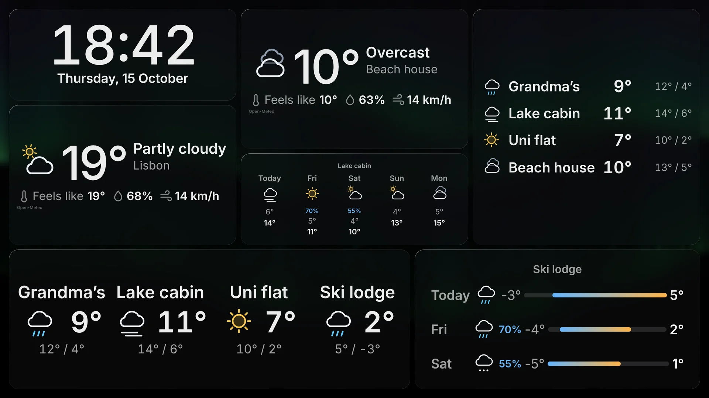
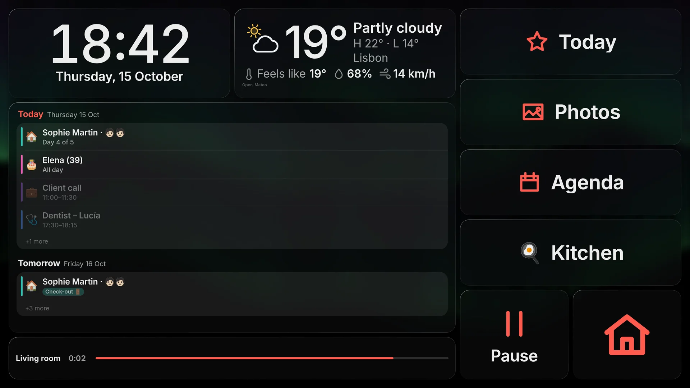

# Using Marco

What Marco shows and how to set it up in the admin panel: layouts, calendars, the family features, custom screens,
photos, several screens, alerts and backups. Connecting outside services (Google, Microsoft, iCloud, Home Assistant,
Spotify, Mealie, weather, electricity prices...) is in [INTEGRATIONS.md](INTEGRATIONS.md); installing is in
[INSTALL.md](INSTALL.md).

**Contents:** [How it works](#how-it-works) · [The display](#the-display) · [The admin panel](#the-admin-panel) ·
[Planner](#a-planner-for-a-busy-family) · [Family](#family-routines-stars-and-meals) ·
[Family access](#family-access-a-dashboard-on-each-phone) · [Custom screens](#custom-screens) ·
[Data cards](#data-cards) · [Private links & pairing](#private-display-links--pairing) · [Photos](#photos) ·
[Several screens](#screens-and-connected-devices) · [Alerts](#alerts-and-scheduled-messages) ·
[Backups](#backups-and-activity)

## How it works

<picture>
  <source media="(prefers-color-scheme: dark)" srcset="media/how-it-works-dark.webp">
  
</picture>

- One small **Node.js server** (no database, no native modules) fetches and caches your calendars, weather and news,
  stores your settings and photos in a `data/` folder and serves two web apps.
- **Displays** are just browsers: a Raspberry Pi in kiosk mode, an old tablet, a smart-TV browser. Each one opens its
  screen's **private link** (`/d/<key>`) or is **paired** with a code. They receive changes right away through
  Server-Sent Events.
- The **admin panel** at `/admin/` works from any phone or computer on your network.
- Home Assistant can push alerts and night mode through webhooks, and Marco can read its weather and sensors.

More detail: [ARCHITECTURE.md](ARCHITECTURE.md) and [API.md](API.md).

## The display


| | |
|---|---|
|  |  |
|  |  |
|  |  |

**Layouts for every room.** *Today*, *Per person*, *Photo frame*, *Two weeks*, *Board* and *Bedside*:

| | |
|---|---|
|  |  |
|  |  |
|  |  |

**Modern or Classic, per screen.** Modern is the default; Classic keeps the original look:


**Or build your own.** *Custom* screens put any cards, at any size, wherever you want them: the calendar, the
family's routines, your Home Assistant lights, heating and blinds, crypto, sports and stocks. Several screens can take
turns on one TV in a carousel. See [Custom screens](#custom-screens).

**Glass options** (Modern style): automatic, clear or tinted glass, with a dark, light or photo-coloured tint,
transparency, blur and a light edge:


- **Calendar:** month (a number of weeks, or *Auto*), agenda and week views; twelve layouts (*big calendar*,
  *two weeks*, *left/right*, *top/bottom*, *agenda*, *today*, *per person*, *board*, *big time*, *photo frame*,
  *bedside*, *planner*) plus three for kids (*routines*, *family*, *meals of the week*), landscape or portrait, each
  calendar with its own colour.
- **Busy days:** a day with more events than fit lists them as small one-line entries, and weeks with more events get
  more height; what still does not fit takes turns.
- **Planner for busy families:** events can show as *cards* (the time on top, the title below on up to two lines,
  stacked in each day) instead of one-line chips, and *Auto* weeks picks 2 to 6 rows so every day fits its events at a
  readable size. The *Planner* layout puts the clock, the date and the weather on top and the month below; see
  [A planner for a busy family](#a-planner-for-a-busy-family).
- **Layouts for every room:** *Today* shows the day hour by hour with a line for now, the next event in large type and
  the weather for the coming hours (the kitchen in the morning). *Per person* gives each calendar its own column with
  today and tomorrow (pick up to five in *Layout*). *Board* is a family organisation board: to-dos, countdowns, the
  message of the day, upcoming birthdays and a short agenda. *Photo frame* leaves the photo alone with a small clock
  card in the corner you choose. *Bedside* is a huge, very dim clock with the next event and the temperature that
  dims further at night. *Two weeks* is the month grid with two roomy rows.
- **Two styles per screen:** *Modern* (the default), a minimal Apple-like look with glass cards over the photo,
  a Lock Screen clock and an iOS-style month grid, or *Classic*. The style is independent of the layout. A third
  card, *Kids*, is the Modern style with the kids layouts: soft colours on a plain background.
- **Family routines, stars and meals:** up to six people with an emoji or a photo and a colour, morning, afternoon and evening
  routines that earn stars, rewards to spend them on, and the meals of the week. Kids tick their routines on the TV
  (touch screens) or on a phone, from a QR code on the screen; see [Family: routines, stars and meals](#family-routines-stars-and-meals).
- **A dashboard on each phone:** each person of the household can send a message to the screens, turn privacy mode
  on or off, switch night or day mode, and add to-dos and events from their own phone, with only what you allow and
  no admin password. They get in with a private link or a code shown on a screen; see
  [Family access](#family-access-a-dashboard-on-each-phone).
- **Glass options** for the Modern style, per screen: automatic (adapts to each photo), clear or tinted; transparency,
  blur, a dark, light or photo-coloured tint and a light edge, with a live preview in *Layout*.
- **Automatic emoji:** 🎂 birthdays, ✈️ flights, 🩺 doctor, 🎒 school, ⚽ sports, 🍽️ dinners, 💼 meetings, 🏖️
  holidays, 🚗 car, 🐾 vet and more, from editable keyword rules (35 categories with about 1,000 keywords in English,
  Spanish, Portuguese, Dutch, Danish, Polish and German out of the box).
- **Birthdays with age:** "🎂 Grandma Isabel (72)", from a birthdays calendar, entered in the admin, imported from a
  contacts file (.vcf from Google Contacts, iCloud or Outlook) or from Google Contacts through a linked Google
  account. Titles from your calendars are tidied to just the name ("Astrid's Birthday" shows as "🎂 Astrid"); turn off *Tidy birthday
  titles* to keep them as they are.
- **Vacation-rental feeds** (Airbnb "Reserved", Booking, or property-management tools that publish titles like
  `🏠 Guest - 4p+1m` and `Adults/Children/Infants` description lines): check-in → check-out bars across the days,
  guests as 🧑🏻🧒🏻👶🏻🐶 icons, 🚪 check-outs, "Check-in today" highlights and blocked dates you can hide
  ([setup](INTEGRATIONS.md#vacation-rentals)).
- **Highlights and countdowns:** "In 18 min · Client call", "Check-out · Tomorrow", "🎃 Halloween party · Tomorrow!",
  "✈️ Trip to Madeira · In 12 days".
- **Weather:** current conditions, hourly and daily forecast from a free source of your choice:
  [Open-Meteo](https://open-meteo.com/) (no API key, with a choice of forecast model: ECMWF, DWD ICON, NOAA GFS,
  Météo-France, UK Met Office and more), [MET Norway](https://api.met.no/) (no API key) or
  [Pirate Weather](https://pirateweather.net/) (your own free key). The screens credit the source in small type.
  Each screen can show the weather of its own place, and a Custom screen can show several places at once.
  Add your own [Home Assistant](https://www.home-assistant.io/) weather entity and indoor sensors; animated rain/snow, or an optional
  realistic effect with drops on the glass, layered snow and sun rays on clear days (the photo is never blurred).
  Sources and settings: [Weather](INTEGRATIONS.md#weather).
- **News ticker** from any RSS/Atom feed, a to-do list and a message of the day. Each to-do card picks its lists, its
  title, an icon and which tasks (all, the important ones, or those due today), so one screen can show *Shopping* and
  *Chores* side by side; classic screens set the same on the To-do page.
- **Electricity price:** a widget with the day-ahead price of your bidding zone (most of Europe): a chart of today
  and tomorrow, the price now, the cheapest hours ahead or the next 24 hours, with your own grid fees and VAT (in
  Denmark, your grid company's tariff hour by hour; in any country, your own time bands). See
  [Electricity prices](INTEGRATIONS.md#electricity-prices).
- **Photo background:** stock photos, your own gallery or albums from your [Immich](https://immich.app/) library,
  WebGL transitions, slow zoom, a soft "aurora" ambient effect, and **smart cropping** that keeps the subject (faces,
  pets) in the part of the screen not covered by the clock or the weather. Portrait photos can be shown whole over a
  blurred copy of themselves. See [Photos](#photos).
- **Easy to read:** panel blur and shade adapt to the photo; small screens get larger relative type; night mode dims
  the screen on a schedule.
- **Live updates:** changes saved in the admin appear within a second through Server-Sent Events; data refreshes
  in place without reloading the page, and the screen keeps showing the last data if the server goes away.
- **Announcements:** full-screen cards with a chime ("🧺 The washing machine is done"), and **scheduled
  messages** ("🗑️ Take out the bins", Tue and Fri 20:00 to 22:00).
- **Private mode** per screen for when you have guests: events show as "Busy" (or are hidden), by hand, on a
  schedule or from Home Assistant, and the server filters them before they reach the screen.
- **Built for the Pi:** 30 fps cap, pauses when hidden, `?lite=1` turns off WebGL entirely.

<br clear="right">

## The admin panel

| | |
|---|---|
|  |  |
|  |  |
|  |  |
|  |  |

- **Home dashboard:** connected screens, next events, calendar health, weather, active alerts, recent activity and
  quick actions (refresh, identify, night mode, send an alert).
- **Calendars:** iCal/ICS URLs (including `webcal://` and self-signed HTTPS), **Google Calendar** through OAuth,
  **Outlook / Microsoft 365**, **Apple iCloud** (a guide to get the calendar's public link), public holiday presets,
  per-calendar colour, emoji, type (general / vacation rental / birthdays / holidays) and refresh rate. How to connect
  each one: [INTEGRATIONS.md](INTEGRATIONS.md).
- **Local events** (one-off or repeating weekly / monthly / yearly, with exceptions) and **birthdays** (with CSV and contacts-file import).
- **Filters and overrides:** hide ("Not available"), rename, or force emoji/colour for a series, with a live preview of
  the next 14 days. **Icon rules** with a tester. **Countdowns**.
- **Photo gallery:** drag and drop, in-browser optimisation (EXIF rotation, resize, thumbnails), iPhone **HEIC**
  conversion, automatic focal point with a manual editor, duplicate-name handling.
- **Custom CSS** per screen, for the changes the settings do not cover, and your own **HTML over the whole screen**
  (shown always or between two dates each year; it runs no scripts).
- **Seasonal decorations:** Christmas lights with a little snow, Halloween lights and bats, New Year confetti, by the
  date or always.
- **Multiple screens** (living room, kitchen, hallway) each with its own layout, background, calendars and widgets,
  and a **Connected devices** page (resolution, browser, version, reload / identify / night mode per device).
- **Private display links and pairing:** every screen has an unguessable link (`/d/<key>`, QR code, one-click
  regenerate) and new devices can be paired with a 6-character code; paired devices can be renamed or revoked.
- **Alerts:** send now or schedule; **API tokens and webhooks** for Home Assistant and scripts.
- **Doorbell camera:** when someone rings, Home Assistant tells Marco and the screens show the camera full screen for
  a while, with a door chime (it also wakes screens in night mode). See
  [Doorbell camera](INTEGRATIONS.md#doorbell-camera).
- **Backups** (automatic, export/import with preview), **activity log**, **command palette** (Ctrl/Cmd + K),
  phone-friendly layout, English / Spanish / Portuguese / Dutch / Danish / Polish / German (native speakers welcome to
  review, see [Adding a language](../CONTRIBUTING.md#adding-a-language)).

| | | |
|---|---|---|
|  |  |  |
|  |  |  |
|  |  |  |
|  |  |  |

| | |
|---|---|
|  |  |

<p align="center">
  
  
  
</p>

## A planner for a busy family

When a family has several events a day, the month grid with one-line chips fills up and days end up with "+3". For
a screen in portrait (a TV on its side, a tablet), Marco has a planner setup:

1. In *Layout*, pick **Planner**. The clock, the date and the weather (with the next days) go on top and the month
   fills the rest of the screen. Picking it also turns on *Auto* weeks and *Cards*.
2. In *Calendars → Calendar view*, adjust if you like:
   - **Weeks to show: Auto** picks 2 to 6 weeks, as many as fit with *Max. visible events per day* at a readable size
     (with 6 you get about 3 weeks on a portrait 1080×1920 screen). It is worked out again when the screen turns.
   - **Event style: Cards** shows each event as a small card: the time on top (and the end time if you turned it on),
     the title below on up to two lines. Events of several days stay as bars across the week.
   - A day with more cards than fit takes turns (*Rotate busy days*) or shows "+N". Titles longer than two lines
     scroll up when *Slide long titles* is on.
3. On a landscape screen, *Time and weather* in the Planner card of *Layout* chooses where the clock and the weather
   go: in a side column (the default), or in a low strip at the top or the bottom. With the strip the month takes the
   whole width (at most 4 weeks) and the weather is one row: now, the next hours and the next days, hiding what does
   not fit. Portrait screens always have them on top.

Nothing changes for screens that do not use these options: the default is still one-line chips and a fixed number of
weeks. *Cards* and *Auto* also work with the other layouts, in the month and week views. With cards, *Compact busy
days* is not used (cards already stack up in each day).

## Family: routines, stars and meals

*Content → Family* (turn it on at the top of the page) has four tabs:

- **Members:** up to six people, each with a name, an emoji or a photo, a colour and, if you like, their own calendar
  (their avatar then shows on its events). Mark the kids: only kids earn stars. Tap the avatar to pick an emoji or
  *Upload photo*: drag the photo to frame the face, zoom with the slider (or the mouse wheel, or two fingers), and
  save. The crop happens in the browser and only a small square is sent; the server keeps it without its camera data
  (location, date, device).
- **Routines:** what each person does and when (morning, afternoon, evening or any time), on which days and for how
  many stars (0 to 20). *Add example routines* fills in a few to start with. Today's routines can be ticked here too.
- **Rewards:** what the stars buy ("Pick Friday's film 🎬, 10 stars"), whether stars are shown at all and whether
  rewards can be redeemed from a phone. Each kid's balance, +1 / -1 or a custom adjustment with a note, and the
  history with *Undo*. Rewards are never redeemed on the TV.
- **Access:** the family link (`/f/<key>`) with its QR code, to create, copy, replace or remove. For the screen chosen
  in the admin: allow ticking by touching it, show the QR code, who appears on it, and what privacy mode does
  (initials only, or hide the routines).

*Content → Meals* plans breakfast, lunch, snack and dinner (pick which ones) for each week, with a template for the
weeks you do not plan: *Copy last week*, *Save as template* and *Clear this week*. If you plan meals in Mealie, see
[Meal plan from Mealie](INTEGRATIONS.md#meal-plan-from-mealie).

In *Layout*, the **Kids** style card shows three layouts:

- **Routines:** a card per person with today's routines grouped by time of day (the current one open and
  highlighted), a progress bar and the stars. "All done!" when everything is ticked.
- **Family:** a greeting, today's and tomorrow's events, everyone's routines, today's meals, the to-do list and how
  far each kid is from the next reward.
- **Meals of the week:** seven days of meals with today highlighted, the time and what is next today.

The kids layouts need the Modern style (with Classic the screen shows the big calendar) and turn off the photo
background so the colours stay soft and readable. They work in landscape and portrait.

**On a phone:** the family link opens a small page (no login) with everyone's progress, each person's routines with
big tick buttons, their rewards (redeeming only when you allowed it) and today's meals. Add it to the home screen. The
link only gives access to the family page, never to calendars or settings; replacing it in *Access* stops the old one
at once. The QR code only shows on screens that open their private link, are paired, or are on the local network, so
it never reaches a screen opened through `PUBLIC_URL` in open mode.

**On a touch screen:** with *Allow ticking by touching this screen* on, kids tap a routine on the TV. It is off while
the screen is in privacy mode, and inside the admin's preview.

What was done (routines ticked, rewards redeemed, adjustments) is kept in `data/family.json` for 90 days; older entries
are folded into each kid's balance, so stars never change. *Export* includes it, and importing the *Family* section
brings it back.

Profile photos are stored in `data/avatars` and only reach the family page (with its link), the admin and the
screens that show that person. A screen in privacy mode keeps the emoji. Exports include the photos. A photo you
replace or remove, or the photo of someone you remove, is deleted a week later, so restoring a recent backup brings
it back.

### Family access: a dashboard on each phone

*Family → Access → Family access* gives a person their own dashboard on the phone (`/my`), without the admin
password. *Add person*, give a name (and pick the family member it is, for the avatar and colour) and tick what they
may do:

- send a message to the screens (all of them, or only the ones you choose); it shows as an announcement with their
  name for 1 minute, 10 minutes or an hour
- turn private mode on or off, on every screen at once
- switch night, day or auto mode on every screen
- add to-dos to the list typed in Marco
- add events to the local calendar (a day, all day or at a time)

Two ways in: the private link the admin shows once when the person is added (copy it or scan its QR code; *Create a
new link* replaces it), or *Show a code*: pick a screen and it draws a 6 character code for two minutes, with a QR
code (only on a screen opened with its private link or paired, never on one in open display access mode). The person
types the code at `/my` or scans the QR code. Either way the phone gets a token of its own, listed under the person,
so one phone can be removed alone. *Remove person* stops their link, phones and codes at once.

The phone only ever gets the person's name and the controls you allowed. Each action is checked again on the server,
so a permission you take away counts from the next tap. Nobody with this access gets into the admin or sees
calendars, photos or passwords. Messages, private mode changes, night mode, to-dos and events are in the activity log
with the person's name. Tokens and links are stored as hashes in `secrets.json` (a code is only on its screen for its
two minutes, and goes away once used); wrong links, tokens and codes are rate limited per address, and overall for
clients outside your network (a valid link or phone still gets in then; codes wait until the count goes down). Behind
a reverse proxy or a tunnel, set `TRUST_PROXY`: otherwise every phone from outside has the proxy's address and they
all share one limit. A person has at most 3 messages on the screens at once (a new one replaces their oldest), and a
message never takes down an announcement someone else sent. An export with private data keeps the people, their
permissions and their phones.

## Custom screens

*Layout → Custom* lets you build a screen yourself. Pick a template (or *Copy my current design* to start from the one
you have, or *Calendar only* for one big calendar), then drag cards from the palette onto a 24×16 grid (16×24 on a
portrait screen): clocks, the month, the week, the agenda, the weather, photos, countdowns, the family cards, your
Home Assistant devices, crypto, sports and stocks, a value you send from anywhere, or a bit of your own HTML.

Sizes are free: a card can be any width and height in whole cells, from a small tile to the whole screen, within
what each kind of card can show well. Pull the corner handle to resize it; a tag shows its size in cells as you
drag, and cards never overlap. Set its content, size and look (glass, a solid colour or no card) in the panel on the
right. *Preview* shows the real screen before you save, and *Cancel* leaves it as it was.

Cards can also be very small. Nearly every card has a compact look for a tiny box: a light, a switch or a sensor on
one line, the clock or the next event as a strip, the forecast as a row of icons, a sparkline for a chart. A screen
takes up to 48 cards, and *Density → Compact* puts them closer together, for the dense dashboards people bring over
from Home Assistant.


| | |
|---|---|
|  |  |
|  |  |
|  |  |

The editor:

| | |
|---|---|
|  |  |
|  |  |
|  |  |

A few things worth knowing:

- Each card can show only while something is true (a Home Assistant state or a value you send) or only at certain
  hours, and can be hidden without deleting it. The editor marks why a card is hidden right now.
- Each calendar card picks which of the screen's calendars it shows, so one screen can have the school calendar on
  the left and the family's on the right.
- **Rotating card:** one spot that shows 2 to 6 cards in turn, every few seconds, with a soft fade. Any card can go
  in it; the next days and the next hours sharing one box is where it starts.
- **Weather in several places:** each screen can show the weather of its own place (*Weather → Location of this
  screen*), each weather card can have a place of its own, and the *Weather in several cities* card shows 2 to 8
  places at once, as a list, a grid or a single row. Every place is fetched once and shared by all the screens.
- **Touch screens:** the *Navigation* cards are buttons to another screen of the house (*Go to screen*, or *Home*),
  *Pause carousel* and *Carousel progress*. With touch on, a swipe left or right moves the carousel to the next or
  the previous screen. After a few minutes without a touch the screen goes back to what it usually shows. On an
  all-in-one Pi, *Exit kiosk* and *Shut down* close the full screen browser or power the Pi off from the screen itself
  ([Exit kiosk and Shut down](INSTALL.md#exit-kiosk-and-shut-down)).
  Every carousel also has its own *Touch screens* settings, for any layout: *Swipe to change screen* (the screen
  you swipe to gets its full time, and only the TV you touch changes), *Press and hold to pause* (the screen stays
  while your finger does) and *Position dots* at the bottom, always or only on touch screens. A TV with no touch is
  not affected.
- The clocks and the date card take their own *Time colour* and *Date colour*, and charts (a sensor's curve, crypto,
  electricity prices) sit *Below* the numbers or in the *Background* behind them.
- Landscape and portrait: the portrait view is worked out from the landscape one until you change it yourself.
- *Export this screen* saves the layout as a file without anything personal (no calendars, people, entities or
  photos); after an import you pick those again.
- **Carousels** put several screens in a loop on the same TV, each for as long as you choose, with an animation
  between them (*System → Carousels*). A home screen, the family's morning and the data screen can take turns on one
  wall; every TV on the same carousel switches at the same moment.
- Custom is a Modern design. Modern, Classic, Kids and their layouts stay exactly as they were.
- Home Assistant cards (lights, climate, blinds, cameras and more) and the *Now playing* card for Spotify are set up
  in [INTEGRATIONS.md](INTEGRATIONS.md#home-assistant).

| | |
|---|---|
|  |  |


### Data cards

The *Data* group of the palette has three cards. Your Marco server fetches the numbers, caches them and shares them
with every screen; a screen never talks to these services itself.

| Card | Source | Key |
|---|---|---|
| **Crypto:** 1 to 6 coins with price, change and a 24 h, 7 day or 30 day curve, as a list or one large card | [CoinGecko](https://www.coingecko.com/) public API | none |
| **Sports:** live scores, next games and results for up to four teams or competitions, with crests | ESPN's public site API (unofficial and undocumented, so it may change without notice) | none |
| **Stocks:** up to 12 symbols as a scrolling line or a list | [Finnhub](https://finnhub.io/) | your own, free: paste it in the Stocks card's settings in the editor |

Prices are asked for every couple of minutes at most (scores every minute while a game is on), and a failed call
keeps the last numbers and says how old they are.


**Values from anywhere.** The *Value* card shows a number or a short text you push to Marco: the solar panels'
production, the washing machine's state, the bin day. Send it with an API token that has the `values` scope:

```bash
curl -X POST -H "Authorization: Bearer $TOKEN" -H "Content-Type: application/json" \
  -d '{"values":[{"key":"solar.today","value":12.6,"unit":"kWh"},{"key":"washer","value":"Done"}]}' \
  http://homeserver.lan:3000/api/hooks/values
```

A screen only receives the keys its own cards show. Details, limits and a Home Assistant automation are in
[API.md](API.md#pushed-values-valor).

<br clear="right">

## Private display links & pairing

Since 0.3 every screen is **private** by default: a browser only shows the calendar once it has opened the screen's
**private link** or has been **paired** from the admin. Without one it shows a pairing code and nothing else. That
makes Marco safe on shared networks (flat-share Wi-Fi, office) and lets you reach it from the Internet behind HTTPS.

| | |
|---|---|
|  |  |
|  |  |

- **Private link:** *Screen → Settings → Private link* shows the selected screen's link, e.g.
  `http://homeserver.lan:3000/d/3f6c0a52-9d1e-4b7a-a2c4-0e5b8f1d2c37`, with **Copy**, a **QR code**, **Open**,
  **Regenerate link** and the ready-to-paste Raspberry Pi command. Bookmark it on a tablet, use it as the kiosk URL, or
  scan the QR with the device. The link is the key: whoever has it sees that screen (and only that one, since
  `?screen=` is ignored), so keep it to your own devices.
- **Pairing:** no long links to type on a TV. Open the plain address (`http://homeserver.lan:3000/` or `/pair`) on the
  new device and it shows a big **6-character code** and a QR code. On your phone open *Connected devices → Pair a
  screen* (or scan the QR: it opens the admin with the code filled in), type the code, pick the screen and a name.
  The admin then shows the address of the screen that is waiting with that code; confirm it is the one in front of
  you. The device starts within two seconds and keeps its own device token in the browser's storage. This suits tablets, TVs
  and browsers you keep using. The Raspberry Pi kiosk runs Chromium in incognito mode (nothing survives a restart),
  so give it the private link instead.
- **Paired devices:** *Connected devices* lists them with the screen they show and when they were last seen; **Edit**
  renames or moves one to another screen, **Revoke** cuts it off.
- **Regenerate / revoke:** *Regenerate link* replaces the key at once; screens using the old link (or a revoked
  device) switch to “This link is no longer valid”, wipe their cached data and offer a new pairing code.
- **Display access mode** (*Security → Display access*): **Private** (default for new installs) or **Open (local
  network)**, the 0.2 behaviour, where `/` and `/?screen=<slug>` work without a key. **Upgrading from 0.2 keeps Open**
  so no kiosk goes blank, and the admin recommends switching: open each display's private link (or pair it) first;
  when you save Private, keyless displays show a pairing code (switching back to Open brings them back by themselves
  within about 30 s). The admin preview and *View screen* keep working with your admin session either way. Restoring
  a backup or importing a file never changes this mode.

| | |
|---|---|
|  |  |

The key is a random **UUIDv4** (122 random bits): easy to read and type on a Pi (lower-case hex, no ambiguous
letters) and impossible to guess. Brute-force math, what is logged (nothing secret) and the full threat model are in
[SECURITY.md](../SECURITY.md#private-display-links-and-pairing-threat-model).

## Photos

- **Stock** photos come from [picsum.photos](https://picsum.photos/) (free, no key). **Gallery** uses your own photos;
  **Mixed** alternates both. Set interval, brightness, transition and ambient effect in *Background*. Albums from
  Immich: see [Immich](INTEGRATIONS.md#immich-photo-albums).
- **Weather effect** (*Background*, `background.weatherFx`): *Off*, *Simple* (light rain/snow particles, the default)
  or *Realistic* (drops on the glass that bend the photo, faint rain streaks, layered snow, soft sun rays on clear
  days). Both draw only over the photo and need WebGL (Realistic also needs the WebGL photo transition);
  `?lite=1` turns them off.
- **Special backgrounds** (*Background*): other photos on some days. A rule says when (*Event today with…* a word of
  the title, accents and capitals ignored, on the screen's calendars or the ones you pick; *Between two dates*, every
  year, also across New Year; *A single day*; *A birthday* from *Birthdays*), which photos (picked from the
  gallery, or an Immich album) and how often they change (*As usual*, the background's interval, or its own, for
  example every hour, counted from when the rule began or the screen loaded, not on the hour). The first rule that
  matches wins; with none, the normal background. The server checks the rules every minute in the server's time
  zone, so the screen changes at midnight or soon after an event is added or removed. Privacy mode with *hide photos* still shows stock photos.
- **Photo order** (*Background*): *Random* (shuffled, without repeating the previous batch), *Newest first* or
  *By name*. The sequential orders continue where the screen left off and start over at the end.
- **Choose which photos are shown**: every photo in the gallery has an eye toggle to take it out of the rotation (or
  put it back) without deleting it. The counter shows how many are in rotation; filter by *In rotation* / *Hidden*
  and use *Select* to show or hide many photos at once. If every gallery photo is hidden, the screen falls back to
  stock photos.
- Upload in **Admin → Gallery** by drag and drop (JPG, PNG, WebP, AVIF, GIF and iPhone **HEIC**, up to 100 MB each).
  Photos are optimised **in your browser** before upload (rotated according to EXIF, resized to max 2560 px, saved as
  JPEG, with a 480 px thumbnail), so neither the server nor the Pi has to process images.
- A **focal point** is detected automatically (saliency + skin tones). Click a photo to adjust it: the editor shows
  exactly what the side panel and full-screen layouts will crop, including the bands covered by the clock and weather.
- Tip: **portrait photos** fit the side panel of the *big calendar* layout best; landscape photos work best in
  *big time* and *left/right*.
- Uploading a file with an existing name asks whether to replace it, keep both or skip it. Photos copied by hand
  into `data/photos/` can be optimised later with *Optimize and frame existing photos*.

## Screens and connected devices

Create several **screens** in *System → Screens* ("Living room", "Kitchen", "Hallway"). Each has its own layout,
theme, background, widgets and set of calendars; calendars, rules and integrations are shared. A device shows a screen
through that screen's [private link](#private-display-links--pairing) or by being paired to it (in open mode also
`http://<server-ip>:3000/?screen=<slug>`; without `?screen` the default one ★, but only on the server itself, such as
`http://localhost:3000/` on an all-in-one kiosk: from another device the bare address only says "Open a screen's link").
The **Editing: Living room ▾** switcher in the admin header selects which screen the per-screen pages edit.

*System → Connected devices* lists every browser showing a screen (IP, browser, resolution, pixel ratio, WebGL,
version, last heartbeat, and how it got in: private link, paired device or no key) with **Reload**, **Identify**
(shows the screen name in big letters for 10 s) and **Night / Day / Auto** buttons, plus **Pair a screen** and the
list of paired devices. Outdated displays are flagged; *Reload* fixes them.

## Alerts and scheduled messages

*Alerts → Send an alert now*: title, text, emoji, style (*info*, *success*, *warning*, *urgent*), duration, sound and
target screens. Active alerts survive a server restart. *Scheduled messages* appear at fixed times on chosen weekdays
(windows can cross midnight).

Alerts, night mode, reloads and values can also come from Home Assistant or a script: see
[API tokens and webhooks](INTEGRATIONS.md#api-tokens-and-webhooks).

## Backups and activity

- Every save keeps the previous configuration in `data/backups/` (the 20 newest; quick successive saves count as one).
  *System → Backups* downloads, restores or deletes them and makes manual backups.
- **Export** downloads everything as one JSON file, optionally with secrets (password hash, Home Assistant token,
  Google accounts, API tokens; keep it safe). **Import** shows what changes per section before applying.
- **Download photos (.zip)** puts every gallery photo in one archive, made in your browser. Photos are not part of
  the JSON export, so upload them again in *Photos* when you move to another installation.
- Moving between Marco Cloud and a self-hosted Marco works both ways with the same file. Marco Cloud never exports
  or imports secrets, and it leaves out what it does not offer (Home Assistant, the admin password, open display
  access); the import preview lists what it left out. After a move, pair the screens again and reconnect Google
  Calendar.
- *System → Activity* records sign-ins (and failed attempts), saves, restores, alerts, API usage, displays connecting
  and calendar errors. Passwords, tokens and calendar URLs are never logged.

What is in the `data/` folder: [CONFIGURATION.md](CONFIGURATION.md#data-directory).
